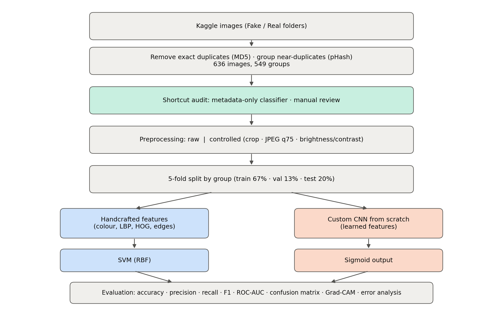
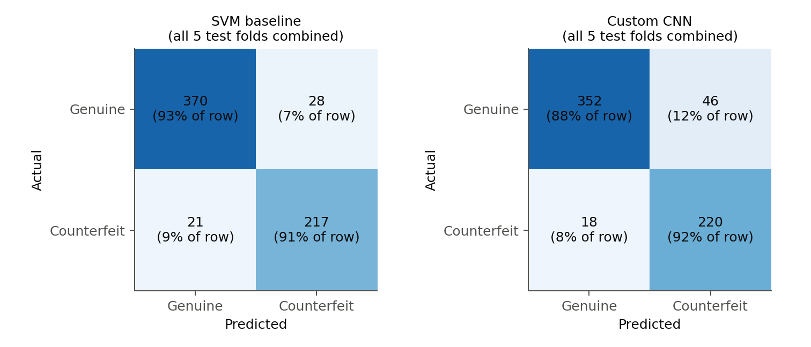
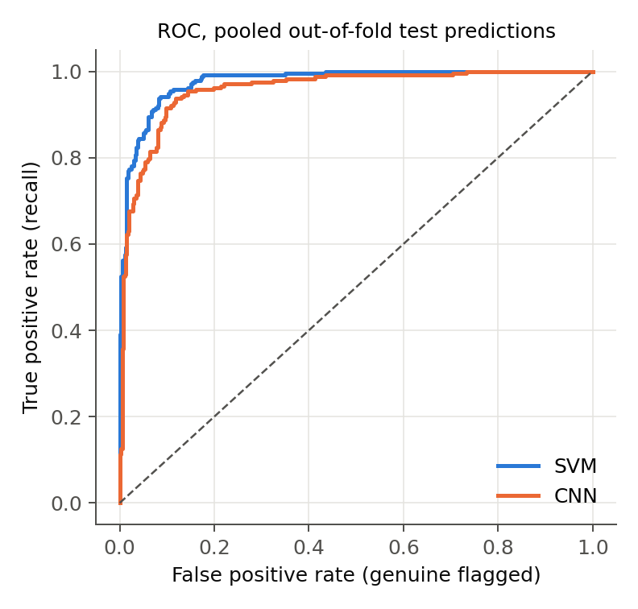
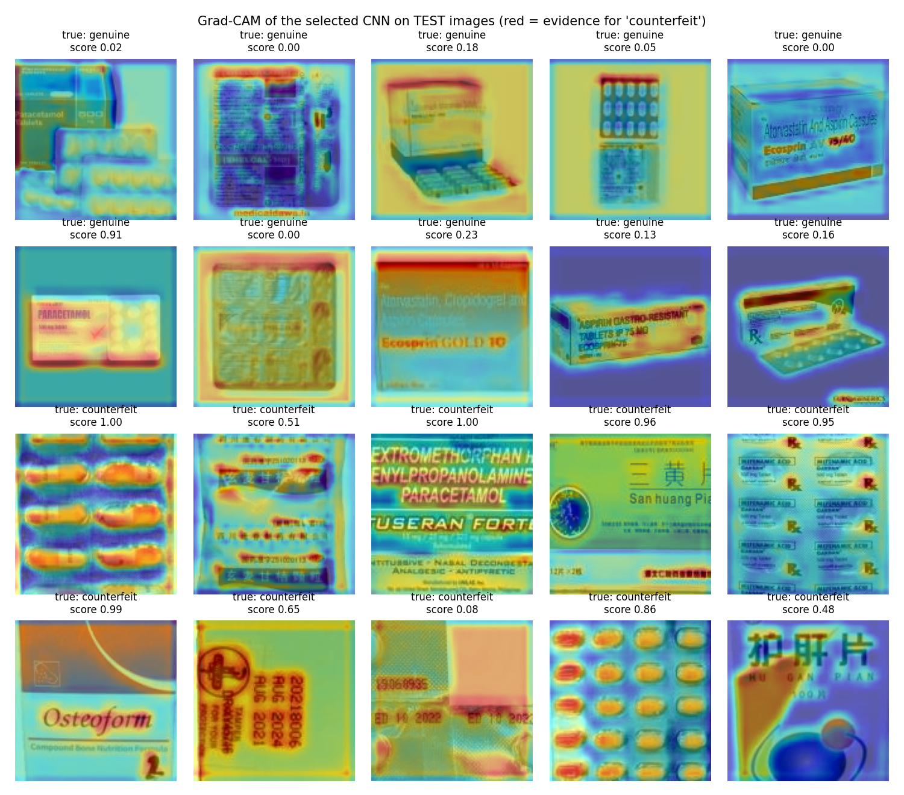

# Counterfeit Pharmaceutical Packaging Detection Using a CNN Trained from Scratch

A custom convolutional neural network (CNN), trained from random initialisation with **no
pretrained weights**, that classifies photos of medicine packaging as **genuine** or
**counterfeit**. It is compared against a handcrafted-feature **SVM** baseline. The project also
includes a **dataset shortcut audit** that tests whether the accuracy reflects real counterfeit
cues or differences in how the two classes were collected.

*M.Tech (Information Technology) course project, AI-ML (MTITE102), Netaji Subhas University of
Technology (NSUT), New Delhi. Supervisor: Dr. Ankush Jain.*

<p align="center"></p>

## Highlights

* **CNN from scratch:** 3 convolution blocks with batch normalisation and global average pooling,
  **101,793 parameters**, implemented in PyTorch.
* **89.9 ± 3.7 % accuracy, 96.0 ± 2.1 % ROC-AUC, 92.4 % recall** on counterfeits, under
  5-fold leakage-free cross-validation.
* **7 controlled experiments** (E1–E7). Replacing Flatten with global average pooling made the
  network **42× smaller** (4.29 M → 0.10 M parameters) with no loss in accuracy.
* **Leakage-free evaluation:** exact duplicates removed with MD5 (2,224 files → 646 unique
  images), near-duplicates grouped with a rotation-aware perceptual hash and never split between
  training and testing.
* **Shortcut audit (the main contribution):** file metadata alone predicts the label with 100 %
  accuracy, and an SVM that sees only the image *border* (packaging masked out) still reaches
  90.7 %. High accuracy on this public dataset therefore measures *how the images were collected*
  more than counterfeit evidence. The repository provides the probes needed to check any future
  dataset.
* **Explainability and demo:** Grad-CAM heatmaps, error analysis and a Gradio web demo.

## Results

Controlled preprocessing, grouped 5-fold cross-validation, mean ± std over the 5 test folds (%):

| Model | Accuracy | Bal. acc. | Precision | Recall | F1 | ROC-AUC |
|---|---|---|---|---|---|---|
| Handcrafted features + SVM | 92.3 ± 2.9 | 92.1 ± 2.9 | 88.7 ± 5.2 | 91.2 ± 3.4 | 89.9 ± 3.8 | 97.8 ± 0.8 |
| **Custom CNN (E2, from scratch)** | 89.9 ± 3.7 | 90.4 ± 3.2 | 83.2 ± 7.4 | **92.4 ± 3.9** | 87.4 ± 4.2 | 96.0 ± 2.1 |

The difference between the two models is not statistically significant (exact McNemar test,
p = 0.09). The CNN misses fewer counterfeits (18 vs 21 false negatives).

**CNN experiments** (one design change at a time; the configuration is selected on *validation* AUC only):

| ID | Change | Parameters | Val AUC | Test Acc | Test AUC |
|---|---|---|---|---|---|
| E1 | Proposal CNN (Flatten, no BN) | 4,287,809 | 95.6 ± 2.2 | 87.1 ± 2.6 | 94.9 ± 1.6 |
| **E2** | **+ BatchNorm + Global Average Pooling** | **101,793** | **95.9 ± 4.2** | **89.9 ± 3.7** | **96.0 ± 2.1** |
| E3 | + Dropout 0.5 | 101,793 | 95.7 ± 4.1 | 87.6 ± 3.0 | 94.9 ± 1.4 |
| E4 | + Data augmentation | 101,793 | 95.0 ± 2.9 | 89.2 ± 3.6 | 95.2 ± 1.5 |
| E5 | + 4th block (256 filters) | 405,409 | 95.2 ± 5.1 | 88.2 ± 3.5 | 95.6 ± 1.2 |
| E6 | E5 with learning rate 3e-4 | 405,409 | 95.8 ± 3.2 | 89.9 ± 2.3 | 96.5 ± 0.5 |
| E7 | E4 with 16/32/64 filters | 27,921 | 94.1 ± 4.6 | 87.4 ± 5.0 | 94.1 ± 1.3 |

**Shortcut study** (accuracy, %):

| Condition | SVM | CNN |
|---|---|---|
| Naive (raw images, random split) | 93.7 ± 2.4 | 86.8 ± 3.9 |
| Leakage removed (raw images, grouped split) | 93.9 ± 1.3 | 89.0 ± 0.6 |
| Controlled (normalised images, grouped split) | 92.3 ± 2.9 | 89.9 ± 3.7 |
| Background probe: border only, packaging masked | 90.7 ± 2.5 | – |
| Metadata only (format, size, brightness; logistic regression) | 100.0 | – |

<p align="center">


</p>
<p align="center"></p>

All per-fold numbers are in [`results/runs/`](results/runs) and all tables in
[`results/tables/`](results/tables).

## Repository structure

```
config.py                    all settings (image size, folds, epochs, seeds)
run_all.py                   runs the whole pipeline, stage by stage
smoke_test.py                1-minute check that the PyTorch code works
run_on_colab.ipynb           runs everything on a free Google Colab GPU
preprocessing/
  preprocessing.py           scan images, MD5 duplicates, pHash groups, raw/controlled preprocessing
  audit.py                   provenance / shortcut audit + manual-review sheets
  make_splits.py             grouped and random 5-fold splits + leakage check
baseline/
  features.py                HSV histogram, colour moments, LBP, HOG, edge density (407 features)
  svm_baseline.py            RBF-kernel SVM, C and gamma chosen on the validation set
cnn/
  model.py                   the custom CNN (PackagingCNN)
  train.py                   training loop, class weighting, augmentation, early stopping
  evaluate.py                runs one configuration on all 5 folds
  gradcam.py                 Grad-CAM heatmaps written from scratch
  final_model.py             trains the model used by the demo
experiments/configs.py       CNN experiments E1-E7
analysis/
  metrics.py                 accuracy, precision, recall, F1, ROC-AUC, confusion matrix
  report_tables.py           tables and figures
  error_analysis.py          misclassified images, Grad-CAM border share
  significance.py            exact McNemar test, SVM vs CNN
demo/app.py                  upload-an-image web demo (Gradio)
models/                      final_cnn.pt (trained weights, 0.4 MB) + final_config.json
results/                     every number and figure reported in the paper
docs/figures/                pipeline and architecture diagrams
paper/                       research paper (IEEE format): PDF and LaTeX source
```

## Dataset

[Fake vs Real Medicine Datasets Images](https://www.kaggle.com/datasets/surajkumarjha1/fake-vs-real-medicine-datasets-images)
(Kaggle, uploader *surajkumarjha1*). The images are **not included** in this repository.
Download the zip from Kaggle and extract it into a folder named `dataset/` in the repository
root. The scanner finds the `Fake/` and `Real/` folders by name. The `train/`, `val/` and `test/`
folders in the archive are copies of the same files and are removed automatically as exact
duplicates.

| Step | Images |
|---|---|
| Image files in the archive | 2,224 |
| Exact duplicates removed (MD5) | −1,578 |
| Near-duplicate groups that mixed both labels, removed | −10 |
| **Final dataset** | **636** (398 genuine, 238 counterfeit) in 549 near-duplicate groups |

## How to run

**Requirements:** Python 3.10+.

```bash
git clone https://github.com/abhinavvt9/counterfeit-packaging-cnn.git
cd counterfeit-packaging-cnn
pip install -r requirements.txt
# put the extracted Kaggle data in ./dataset first

python run_all.py --data dataset                   # full pipeline (a GPU is recommended for the CNN)
python run_all.py --data dataset --stages index audit splits cache svm report   # no PyTorch needed
python analysis/significance.py                    # McNemar test, SVM vs CNN
python smoke_test.py                               # quick PyTorch check (after the cache stage)
python demo/app.py                                 # web demo at http://127.0.0.1:7860
```

| Stage | What it does | Output |
|---|---|---|
| `index` | scan images, remove exact duplicates, group near-duplicates | `results/dataset_index.csv` |
| `audit` | provenance / shortcut audit | `results/audit/` |
| `splits` | 5-fold grouped and random splits, leakage check | `results/splits.csv` |
| `cache` | preprocess every image under both protocols | `cache/*.npy` |
| `svm` | SVM baseline under 3 conditions + background probe | `results/runs/` |
| `cnn` | CNN experiments E1–E7 + shortcut conditions | `results/runs/` |
| `report` | tables and figures | `results/tables/`, `results/figures/` |
| `errors` | error analysis + Grad-CAM | `results/error_analysis/` |
| `final` | train the demo model on all data | `models/final_cnn.pt` |

Finished folds in `results/runs/` are skipped, so an interrupted run can simply be restarted.
To retrain every CNN from scratch, delete `results/runs/E*.json` first.

**Google Colab:** open `run_on_colab.ipynb` in Colab, choose a T4 GPU and run the cells from top
to bottom. It clones this repository, asks you to upload the Kaggle zip, and runs the pipeline
and the demo.

The demo needs only the trained model in `models/`, so `python demo/app.py` works without the
dataset.

## Method in brief

1. **Cleaning and grouping.** MD5 removes byte-identical copies. A 64-bit DCT perceptual hash,
   computed for 4 rotations, groups images whose hashes differ in at most 10 bits (union-find).
2. **Grouped 5-fold cross-validation** (`StratifiedGroupKFold`): about 424 training, 85
   validation and 127 test images per fold. Every image is tested exactly once, and no group
   crosses a split (verified by `results/leakage_report.csv`).
3. **Controlled preprocessing:** centre crop to 128×128, JPEG re-encoding at quality 75, and
   LAB lightness normalisation (mean 55, std 20), so file format, size and brightness can no
   longer reveal the class.
4. **SVM baseline:** 407 handcrafted features, RBF kernel, balanced class weights, C and γ tuned
   on validation F1.
5. **CNN:** [Conv 3×3 → BatchNorm → ReLU → MaxPool] × 3 (32/64/128 filters) → Global Average
   Pooling → Dense 64 → Dense 1. Weighted binary cross-entropy, Adam (lr 1e-3), batch 32, up
   to 60 epochs, early stopping with patience 10.
6. **Analysis:** McNemar test, Grad-CAM, background (border-only) probe, error analysis.

## Limitations

The two classes of the public dataset differ in source, background, framing, language and brand,
so the accuracies above should not be read as a validated counterfeit detector. The model
screens packaging images only and cannot verify a medicine. A dataset with the *same* products
photographed as genuine and counterfeit under the same conditions is needed. See the paper for
details.

## Paper

The research paper (IEEE conference format) is in [`paper/`](paper): `paper.pdf` and its LaTeX
source.

## Authors

* **Abhinav Shankar Tripathi** (2026PIT4212), M.Tech Information Technology, NSUT, New Delhi
* **Saksham Bhatnagar** (2026PIT4210), M.Tech Information Technology, NSUT, New Delhi
* **Dr. Ankush Jain** (Supervisor), Department of Information Technology, NSUT, New Delhi

## References

1. R. R. T. Ramos, K. R. B. Samonte, C. O. Manlises, "Medicine Authentication Based on Image Processing Using Convolutional Neural Networks," *ICCAE 2024*, IEEE, pp. 278–282.
2. R. Geirhos et al., "Shortcut learning in deep neural networks," *Nature Machine Intelligence*, 2020.
3. R. R. Selvaraju et al., "Grad-CAM: Visual explanations from deep networks via gradient-based localization," *ICCV 2017*.
4. N. Dalal, B. Triggs, "Histograms of oriented gradients for human detection," *CVPR 2005*.
5. T. Ojala, M. Pietikäinen, T. Mäenpää, "Multiresolution gray-scale and rotation invariant texture classification with local binary patterns," *IEEE TPAMI*, 2002.

## License

Code: MIT License (see `LICENSE`). The dataset belongs to its Kaggle uploader and is subject to
its own terms.
